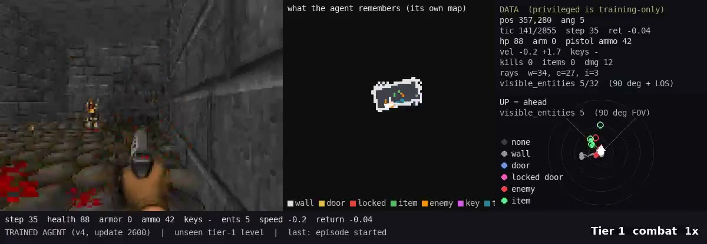

# Can It Play DOOM? — Team We Who Remains - Yugaantar

Yugaantar 2026 · DevForge Track 1. A **1.55M-parameter** agent that plays unseen Doom maps from ego-centric rays, entities and vitals — no god-view, no `A*`.

Weights and code live in this repo. Evaluation uses the official `doom_env` wrapper, vanilla ViZDoom, and **hidden** maps.



**Demo (48s highlights):** [docs/demo/showcase.mp4](docs/demo/showcase.mp4) — [clip list](docs/demo/README.md)

Left: RGB. Centre: the agent’s own EgoMap. Right: rays / entities / vitals. Label in the recording: `TRAINED AGENT (v4, update 2600)` on **unseen** generated tiers.

## Status

Shipped on `main`:

- `DoomAgent` in [`submission/agent.py`](submission/agent.py) + [`submission/brain/`](submission/brain/)
- Git LFS weights: [`submission/weights/policy.pt`](submission/weights/policy.pt), [`odonet.pt`](submission/weights/odonet.pt)
- Training: recurrent PPO + privileged teacher ([`training/ppo.py`](training/ppo.py)), procedural levels ([`training/levelgen.py`](training/levelgen.py)), Freedoom map pool ([`training/pool.py`](training/pool.py))
- 2-page brief: [`brief/Yugaantar_DOOM_brief.pdf`](brief/Yugaantar_DOOM_brief.pdf)

What the demo actually shows (honest):

| Tier | Behaviour |
| --- | --- |
| 0 empty rooms | Reaches the exit quickly |
| 1 combat | Aims and kills; still dies if it walks into a pack |
| 2 multi-room | Fights in corridors; EgoMap fills in |
| 3 keycard | Picks up the red card and keeps exploring |
| 4 gauntlet | Holds a red skull; still stuck on a **yellow** locked door |

The policy is a real trained net, not the random baseline. It is **not** a full T4 solver yet. Hidden eval maps will differ from our generator.

## Run the agent

```bash
git lfs install
uv sync
uv run python validate.py
# watch the trained agent (RGB | EgoMap | rays)
uv run python training/record_demo.py --live --agent submission/weights/policy.pt --label "(v4, update 2600)"
# held-out generated maps
uv run python training/evaluate.py --policy agent --episodes 5
# play yourself (WASD + mouse; R = new map)
uv run python training/watch_random.py --policy human --pool
```

`DoomAgent` loads `submission/weights/policy.pt`. Set `DOOM_AGENT_GREEDY=1` for deterministic eval. The 48s reel is combat → rooms → red key, not empty-room bootstrap or the yellow-lock stall.

## Train

See [`training/README.md`](training/README.md). Short version:

```bash
uv pip install torch==2.15.0 pillow
uv run python training/train_odometry.py --samples 120000
uv run python training/ppo.py --run main --workers 8 --envs-per-worker 4 --updates 3000
uv run python training/select_best.py --ckpts "training/runs/main/ckpt_*.pt" --install
```

## Layout

```
submission/agent.py     eval entry (DoomAgent)
submission/brain/       DoomNet, EgoMap, OdoNet
submission/weights/     policy.pt + odonet.pt (Git LFS)
training/ppo.py         recurrent PPO + teacher distillation
training/levelgen.py    generated curriculum maps
training/pool.py        Freedoom MAP01–32 sampler
training/mapgen/        UDMF builder (doors / keys / layout)
docs/demo/              highlight reel from a live run
env/                    official wrapper (scorer ignores a fork here)
```

## Evaluation contract

| Doc | What's inside |
| --- | --- |
| [docs/CONTRACT.md](docs/CONTRACT.md) | Observation/action spaces and `DoomAgent` |
| [docs/RULES.md](docs/RULES.md) | No rule trees, no aimbots, no SB3 defaults |
| [docs/SUBMISSION.md](docs/SUBMISSION.md) | LFS, 1 GB limit, `requirements.txt` |
| [docs/EVALUATION.md](docs/EVALUATION.md) | Hidden tiers, scoring, timeouts |

Scorer: ViZDoom 1.3.3 + `freedoom2.wad`, skill 3, 9 buttons, frame-skip 4, last commit on **default branch**. 2 GB VRAM / 8 GB RAM / 1 CPU thread.
